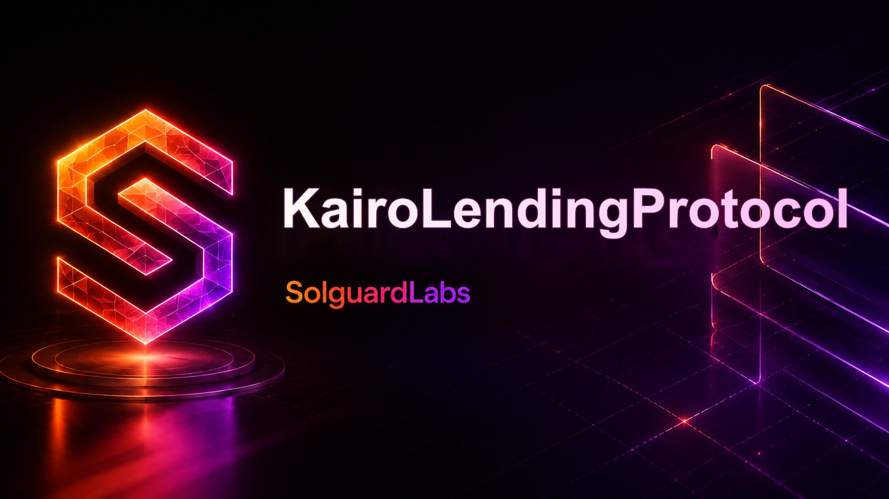

# Kairo Lending Protocol



Kairo es un mercado de crédito multiactivo para EVM. El protocolo permite aportar liquidez, utilizar activos admitidos como garantía, abrir préstamos sobrecolateralizados y liquidar posiciones que dejan de cumplir los parámetros de riesgo del mercado.

El repositorio contiene los contratos, interfaces, bibliotecas, utilidades de consulta, scripts de despliegue y pruebas necesarias para ejecutar Kairo de forma local con Foundry.

## Características

- Mercados independientes por activo de reserva.
- Depósitos y retiradas con contabilidad de participaciones.
- Préstamos sobrecolateralizados con límites por posición y por mercado.
- Tipos de interés variables en función de la utilización.
- Capitalización de intereses mediante un índice acumulado.
- Oráculos configurables con controles de vigencia y límites operativos.
- Liquidaciones parciales con incentivo y cierre máximo configurables.
- Factor de reserva para cubrir costes operativos y desviaciones de mercado.
- Pausa selectiva de acciones sensibles.
- Contratos de consulta para integraciones y paneles de riesgo.

## Modelo del protocolo

Cada mercado mantiene una reserva de un activo prestable. Los proveedores depositan ese activo y reciben participaciones que representan su derecho económico sobre la reserva. La relación entre activos y participaciones evoluciona con los intereses pagados por los prestatarios y con la parte asignada a reservas.

Un usuario puede aportar activos admitidos como garantía y pedir prestado mientras el valor ajustado de su posición sea superior al valor ajustado de su deuda. La valoración utiliza precios normalizados y parámetros específicos por activo:

- relación préstamo-valor;
- umbral de liquidación;
- incentivo de liquidación;
- límite de suministro;
- límite de préstamo;
- factor de reserva;
- antigüedad máxima del precio.

Cuando una posición cruza el umbral de liquidación, un tercero puede devolver parte de la deuda y recibir garantía con el incentivo definido para el activo. Los límites de cierre reducen el efecto de una única operación sobre el mercado.

## Interés variable

El coste del préstamo se obtiene a partir de la utilización de la reserva:

```text
utilización = deuda pendiente / (liquidez disponible + deuda pendiente)
```

El modelo de tipos puede definir una pendiente antes del punto óptimo y otra después. Así, una utilización elevada encarece el crédito e incentiva nuevas aportaciones de liquidez o amortizaciones.

Los intereses se capitalizan al actualizar el estado del mercado. Las operaciones de suministro, préstamo, devolución, retirada y liquidación actualizan previamente la información económica que necesitan.

## Componentes

La implementación se divide por responsabilidad:

```text
src/
├── KairoLendingPool.sol   Custodia, mercados y operaciones de lending
├── core/                  Acceso y protección de llamadas
├── governance/            Configuración y perfiles de riesgo
├── interest/              Curva variable de dos pendientes
├── interfaces/            Superficies ERC-20, precios, tipos y vistas
├── lens/                   Consultas agregadas para integradores
├── libraries/              Tipos, matemáticas y transferencias
├── oracle/                 Enrutamiento y normalización de precios
├── risk/                   Solvencia y cotización de liquidaciones
├── tokens/                 Participaciones de suministro
└── treasury/               Distribución de reservas del protocolo
```

La distribución exacta puede evolucionar; las interfaces públicas y los eventos son la referencia para las integraciones.

### Núcleo y mercados

El núcleo registra activos, parámetros de riesgo y permisos operativos. Cada mercado conserva la liquidez, deuda, reservas e índices necesarios para valorar las posiciones en el bloque actual.

### Oráculos

Los adaptadores convierten precios de distintas precisiones a una unidad común. Las lecturas incluyen marca temporal y estado operativo. Una operación que dependa de valoración requiere una observación válida según la configuración del activo.

### Modelo de tipos

Los modelos de tipos son componentes intercambiables. Reciben el estado de utilización y devuelven tipos por segundo para prestatarios y proveedores, después de aplicar el factor de reserva. Kairo Lens presenta también su equivalente anualizado.

### Liquidaciones

El motor de liquidación calcula la capacidad de pago, la garantía transferible, el incentivo y los límites de cierre. La operación queda acotada por la deuda, la garantía disponible y la liquidez efectivamente aportada por el liquidador.

### Kairo Lens

El contrato de vistas agrega información sin modificar estado:

- liquidez y utilización por mercado;
- tipos actuales;
- saldo suministrado y deuda de una cuenta;
- valor de garantía y capacidad de préstamo;
- factor de salud;
- parámetros y estado del oráculo;
- estimación de una liquidación.

Estas funciones están pensadas para indexadores, interfaces web, bots de seguimiento y herramientas de gobierno.

## Flujo habitual

1. El administrador registra un mercado y configura sus fuentes de precio y riesgo.
2. Los proveedores aprueban el activo y aportan liquidez.
3. Un usuario deposita o habilita garantía.
4. El usuario solicita un préstamo dentro de su capacidad disponible.
5. Los intereses evolucionan con el tiempo y la utilización.
6. El usuario devuelve deuda total o parcialmente.
7. Si la posición pierde cobertura suficiente, un liquidador puede sanearla.

## Requisitos

- [Foundry](https://book.getfoundry.sh/) con `forge`, `cast` y `anvil`.
- Git para instalar dependencias y reproducir el entorno.
- PowerShell, Bash o un entorno compatible para los scripts auxiliares.

Compruebe la instalación:

```bash
forge --version
cast --version
anvil --version
```

## Instalación

```bash
git clone <repository-url>
cd KairoLendingProtocol
bash scripts/bootstrap.sh
forge build
```

El compilador y sus opciones se fijan en `foundry.toml` para que los resultados sean reproducibles.

## Pruebas

Ejecute la suite completa:

```bash
forge test
```

Salida detallada:

```bash
forge test -vvv
```

Las pruebas cubren, entre otros, los siguientes comportamientos:

- suministro y retirada de liquidez;
- apertura y amortización de préstamos;
- acumulación de intereses;
- variaciones en la utilización;
- cambios de precio;
- capacidad de préstamo y factor de salud;
- liquidaciones parciales;
- acumulación de reservas;
- permisos y pausas operativas;
- consultas agregadas de Kairo Lens.

Para generar un informe de cobertura:

```bash
forge coverage
```

Para registrar el consumo de gas:

```bash
forge snapshot
```

## Desarrollo local

Inicie una cadena local:

```bash
anvil
```

Compile y despliegue los componentes mediante los scripts incluidos:

```bash
forge script script/DeployKairo.s.sol:DeployKairo \
  --rpc-url http://127.0.0.1:8545 \
  --broadcast
```

Las claves, direcciones de administración y fuentes de precio deben proporcionarse mediante variables de entorno o archivos locales no versionados. No reutilice credenciales de producción en entornos de desarrollo.

## Configuración de un mercado

Antes de habilitar operaciones, revise conjuntamente:

1. decimales del activo y del precio;
2. liquidez disponible en las fuentes externas;
3. relación préstamo-valor y umbral de liquidación;
4. incentivo y límite de cierre;
5. curvas del modelo de tipos;
6. límites de suministro y préstamo;
7. factor de reserva;
8. periodo máximo de vigencia del oráculo;
9. permisos de pausa y administración;
10. proceso de seguimiento y respuesta operativa.

Los cambios de parámetros deben probarse con escenarios de mercado adversos antes de aplicarse a una red pública.

## Eventos e integración

Los consumidores deben indexar los eventos del protocolo en lugar de inferir cambios únicamente a partir de transferencias ERC-20. Una integración típica observa:

- creación y configuración de mercados;
- depósitos y retiradas;
- préstamos y devoluciones;
- acumulación de intereses y reservas;
- cambios de garantía;
- liquidaciones;
- pausas y reanudaciones;
- actualizaciones de oráculos y modelos de tipos.

Las vistas on-chain son la fuente final para el estado actual. Los eventos facilitan la reconstrucción histórica, pero una aplicación debe tolerar reorganizaciones de cadena y volver a consultar el estado confirmado.

## Integración continua

El flujo de CI compila los contratos, comprueba el formato, ejecuta la suite de Forge y valida el tamaño del código fuente. Las versiones de herramientas y dependencias se mantienen fijadas o revisadas de forma explícita para reducir diferencias entre entornos.

Antes de enviar cambios:

```bash
forge fmt --check
forge build
forge test
bash scripts/check-loc.sh
```

## Consideraciones operativas

- Use cuentas separadas para administración, pausa y operaciones rutinarias.
- Aplique demoras o procesos de aprobación a cambios de riesgo.
- Supervise antigüedad de precios, utilización, reservas y factores de salud.
- Defina límites conservadores al incorporar un activo nuevo.
- Ensaye pausas y recuperación de mercado en una red de pruebas.
- Mantenga un inventario de dependencias y adaptadores desplegados.

La política para comunicar hallazgos de seguridad está disponible en [SECURITY.md](./SECURITY.md).

## Licencia

Este proyecto se distribuye bajo la licencia MIT. Consulte [LICENSE](./LICENSE).
