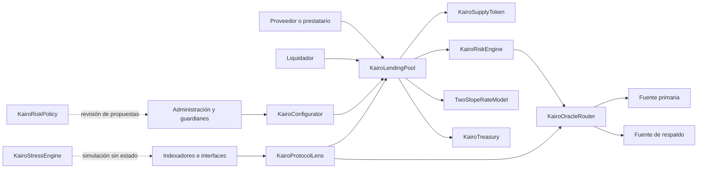
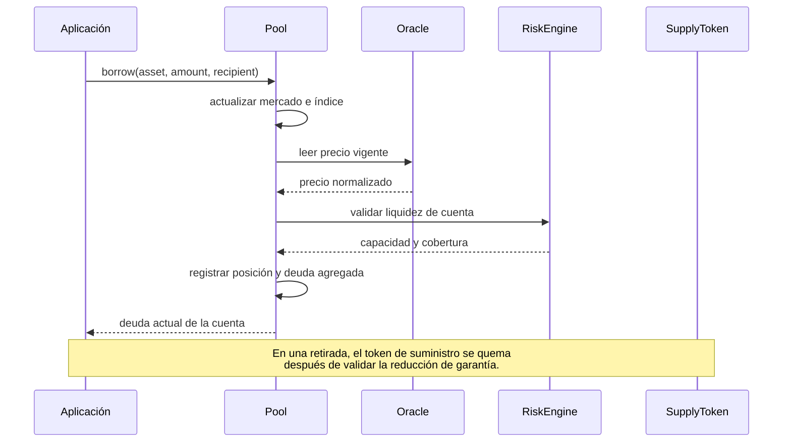

# Arquitectura de Kairo

## Alcance

Kairo separa custodia, valoración, configuración y lectura para que cada cambio tenga una superficie de revisión concreta. `KairoLendingPool` es el único componente que custodia reservas y modifica la contabilidad económica. Los demás contratos calculan, autorizan o presentan información.

## Fronteras de confianza

| Frontera | Responsabilidad | Condición de aceptación |
| --- | --- | --- |
| Activo ERC-20 | Transferir y contabilizar unidades | Código desplegado, decimales compatibles y transferencias verificadas |
| Fuente de precio | Entregar precio y marca temporal | Precio positivo, no futuro, vigente y dentro de la desviación configurada |
| Modelo de tipos | Cotizar tipos por segundo | Dirección con código y curva revisada para todo el dominio de utilización |
| Configurador | Aplicar parámetros autorizados | Rol explícito, límites y lote acotado |
| Tesorería | Recibir reservas reclamadas | Destinatario no nulo y rol independiente |
| Lens | Agregar lecturas | Nunca modifica estado ni sustituye una simulación de transacción |

## Ciclo de una operación

## Estado económico

Cada mercado conserva activos suministrados, deuda agregada, reservas, índices y último instante de acumulación. Cada cuenta conserva principal e índice de referencia. El saldo económico se deriva de esos valores y no del historial de eventos.

Los eventos sirven para indexación y auditoría, pero las integraciones deben reconciliar periódicamente su estado con las vistas del pool. Una reorganización puede invalidar eventos todavía no confirmados.

## Extensión segura

Un nuevo activo requiere un token de suministro propio, una fuente de precio, un modelo de tipos y parámetros de riesgo. Un nuevo adaptador no debe recibir permisos de custodia. Una nueva vista debe vivir en el Lens siempre que no sea necesaria para ejecutar una transición de estado; esta regla mantiene el núcleo por debajo del límite EIP-170.

## Invariantes operativas

- las reservas reclamables no superan el saldo líquido disponible;
- los límites de suministro y préstamo se evalúan antes de aumentar exposición;
- toda reducción de garantía conserva la solvencia de la cuenta;
- un precio vencido o futuro no participa en decisiones de riesgo;
- los cambios administrativos requieren un rol explícito;
- el contrato principal debe conservar margen positivo respecto de 24.576 bytes.
