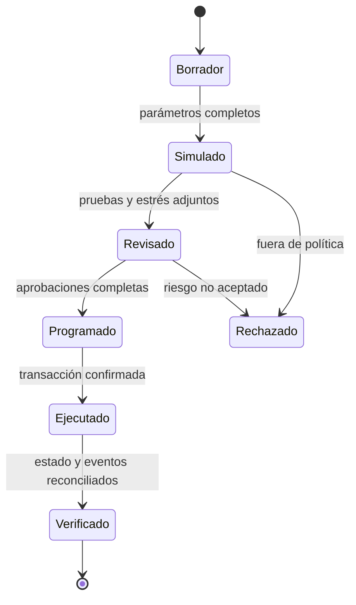

# Gobernanza y cambios de riesgo

## Principio de separación

Kairo distingue administración, configuración, pausa y tesorería. Ningún proceso operativo debe usar una clave con más permisos de los necesarios. La transferencia de administración requiere propuesta y aceptación.

## Flujo de un cambio

## Expediente mínimo

- estado actual y propuesta exacta;
- motivo y horizonte de exposición;
- clasificación de `KairoRiskPolicy` y `policyId`;
- escenarios de estrés con instantánea e identificador;
- impacto sobre utilización, liquidaciones, reservas y concentración;
- plan de ejecución, monitorización y reversión;
- responsables de proponer, revisar, aprobar y ejecutar.

## Cambios por categoría

| Categoría | Ejemplos | Evidencia adicional |
| --- | --- | --- |
| Rutinaria | reducción conservadora sin nueva exposición | comprobación de estructura |
| Riesgo | LTV, umbral, incentivo, factor de cierre | distribución de salud y liquidación |
| Tesorería | reservas y límites | liquidez, cobertura y concentración |
| Gobernanza | fuente, modelo o excepción | revisión integral y plan de contingencia |

## Lotes

`KairoConfigurator` limita los lotes a 32 entradas. Un lote solo debe agrupar cambios con una misma justificación y ventana operativa. Antes de enviarlo, valide unicidad de activos, longitudes, estado vigente y efecto agregado.

## Verificación posterior

Después de confirmar la transacción:

1. leer los parámetros desde el pool;
2. comprobar roles y estado de pausa;
3. consultar precio, tipo y liquidez mediante el Lens;
4. comparar eventos con la propuesta aprobada;
5. repetir el escenario de estrés con el nuevo estado;
6. cerrar o escalar según los criterios definidos.

Una transacción confirmada demuestra ejecución, no aceptación económica. El cambio solo queda cerrado tras reconciliar el estado y observar el periodo de seguimiento establecido.
