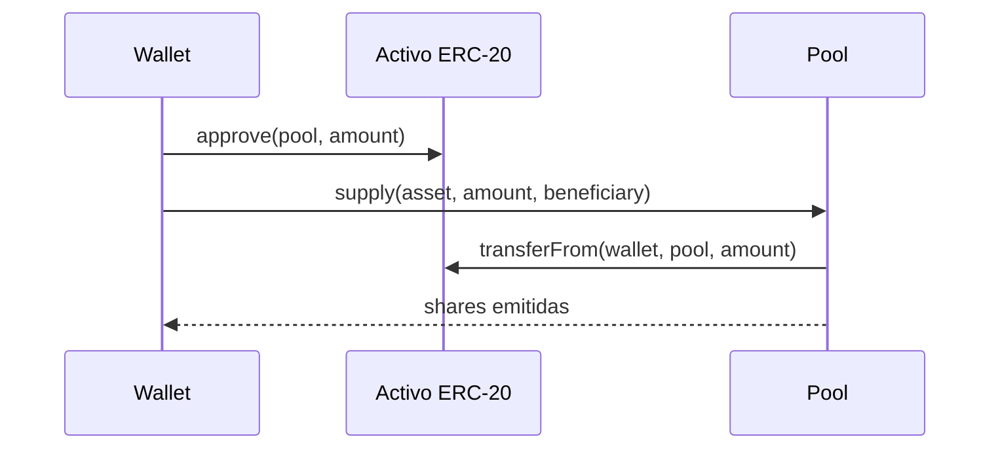

# Guía de integración

## Lecturas recomendadas

Las aplicaciones deben consultar `KairoProtocolLens` para vistas compuestas y el pool para el estado canónico. El Lens ofrece mercados paginados, posiciones, precios, tipos y estimaciones sin modificar estado.

```solidity
KairoProtocolLens.RateView memory rates = lens.previewRates(asset);
KairoProtocolLens.PositionView memory position = lens.getPosition(account, asset);
```

Compruebe siempre los indicadores `valid` y `stale` antes de presentar una cifra como operativa. Una lectura del Lens puede quedar obsoleta en el siguiente bloque.

## Escrituras



Para préstamos y retiradas, simule la llamada contra el bloque más reciente y aplique límites de interfaz. La aprobación debe ser la mínima necesaria para el flujo previsto.

## Eventos

Indexe al menos:

- `MarketListed` e información de configuración;
- `Supplied` y `Withdrawn`;
- `Borrowed` y `Repaid`;
- `InterestAccrued` y `ReservesClaimed`;
- `Liquidated`;
- cambios de estado, límites, fuentes y roles.

Guarde `chainId`, dirección, bloque, hash de bloque, transacción e índice de log como clave de procedencia. Espere confirmaciones y elimine datos derivados de bloques reorganizados.

## Reconstrucción y reconciliación

```text
eventos confirmados -> estado indexado -> lectura periódica del pool -> corrección de deriva
```

No calcule deuda actual solo sumando eventos: el índice evoluciona con el tiempo. Use `borrowBalance` o las vistas del Lens para el valor vigente.

## Errores y reintentos

Una reversión por precio, salud, límite o pausa requiere volver a leer el estado; aumentar gas o reenviar sin cambios no resuelve la causa. Un error de transporte puede reintentarse con el mismo contenido solo después de comprobar que la transacción anterior no fue incluida.

## Entorno local

```bash
bash scripts/bootstrap.sh
anvil
forge script script/DeployKairo.s.sol:DeployKairo \
  --rpc-url http://127.0.0.1:8545 \
  --broadcast
```

Use cuentas efímeras y activos de prueba. Las direcciones emitidas por el script deben almacenarse junto con `chainId`, commit y parámetros de despliegue.
