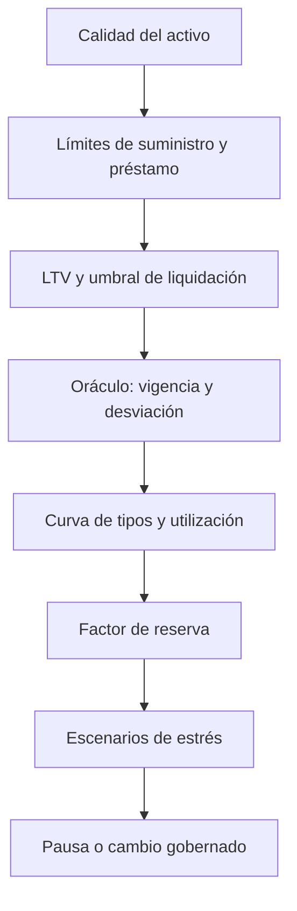

# Modelo de riesgo y estrés

## Capas de control



Ningún parámetro se evalúa aislado. Aumentar el límite de préstamo, por ejemplo, puede cambiar concentración, utilización esperada, velocidad de salida y dependencia de liquidaciones.

## Motor de estrés

`KairoStressEngine` es un componente puro: recibe una instantánea explícita y no consulta ni modifica el pool. Esto permite versionar el escenario y reproducir exactamente un resultado.

Un escenario define:

- salida de liquidez;
- porcentaje de deuda en incumplimiento;
- recuperación sobre la deuda incumplida;
- coste de liquidación;
- recorte de reservas;
- cobertura y liquidez mínimas.

El orden económico es deliberado:

```text
stressedCash = cash × (1 - liquidityOutflow)
defaultedDebt = borrow × defaultRate
recoveredDefault = defaultedDebt × recoveryRate
liquidationCost = recoveredDefault × liquidationCostRate
recoverableDebt = performingDebt + recoveredDefault - liquidationCost
creditLoss = borrow - recoverableDebt
usableReserves = reserves × (1 - reserveHaircut)
supplierLoss = max(creditLoss - usableReserves, 0)
```

El informe agrega pérdida, absorción de reservas, cobertura de proveedores, liquidez, utilización estresada y concentración del mayor mercado.

## Ejemplo de escenario

| Entrada | Valor |
| --- | ---: |
| Activos suministrados | 1.000.000 |
| Deuda | 600.000 |
| Efectivo | 500.000 |
| Reservas | 100.000 |
| Salida de liquidez | 20 % |
| Incumplimiento | 25 % |
| Recuperación | 40 % |
| Coste de liquidación | 10 % |
| Recorte de reservas | 20 % |

El escenario produce 96.000 de pérdida crediticia. Las reservas utilizables absorben 80.000 y quedan 16.000 de pérdida para proveedores: cobertura del 98,40 %. El efectivo estresado es 400.000, un 40 % del suministro.

## Política de cambios

`KairoRiskPolicy` clasifica una propuesta sin ejecutarla:

| Cambio | Revisión mínima |
| --- | --- |
| Sin exposición adicional | Rutinaria |
| Mayor LTV, menor umbral o mayor incentivo/cierre | Riesgo |
| Menor reserva o mayores límites | Tesorería |
| Nueva fuente, nuevo modelo o parámetro fuera de política | Gobernanza |

Si una propuesta activa varias reglas prevalece la revisión más estricta. `policyId` identifica las cotas usadas para que un informe no pueda separarse de su marco de evaluación.

## Señales de seguimiento

- utilización actual y proyectada;
- liquidez libre después de reservas;
- concentración por mercado y por prestatario;
- deuda próxima al umbral de liquidación;
- edad y divergencia de fuentes de precio;
- variación de reservas frente a interés acumulado;
- pérdida y cobertura en escenarios estable, adverso y severo.

Una señal no ejecuta cambios automáticamente. Debe enlazarse con un procedimiento operativo, responsables y criterios de recuperación.
