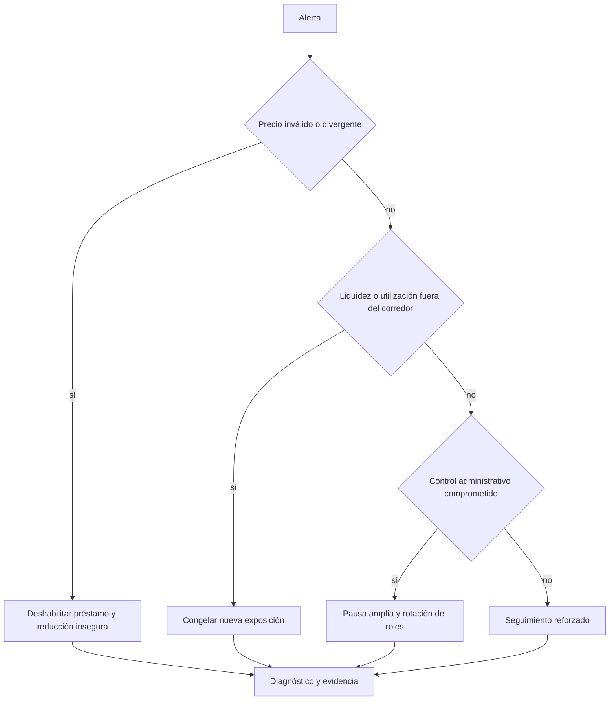

# Operación y respuesta

## Panel mínimo

| Dominio | Métrica | Acción asociada |
| --- | --- | --- |
| Liquidez | efectivo libre y utilización | revisar límites o deshabilitar nuevo préstamo |
| Crédito | deuda, cuentas próximas a liquidación | elevar seguimiento y liquidez de liquidadores |
| Oráculo | edad, fuente activa y desviación | pausar acciones dependientes de valoración |
| Reservas | acumuladas, reclamadas y cobertura | revisar factor y destino de tesorería |
| Gobierno | cambios pendientes y roles | confirmar aprobaciones y expiraciones |
| Código | tamaño de runtime y commit desplegado | bloquear una versión no reproducible |

## Procedimiento de despliegue

1. Fijar commit, compilador, dependencias y parámetros.
2. Ejecutar formato, compilación, pruebas, tamaños y escáner público.
3. Desplegar en una red local o entorno aislado y registrar direcciones.
4. Verificar bytecode y roles iniciales.
5. Configurar fuentes, modelos y límites con exposición nula o mínima.
6. Transferir administración mediante el flujo en dos pasos.
7. Ejecutar comprobaciones de lectura y una operación completa controlada.
8. Archivar manifiesto, transacciones, hashes y responsables.

## Matriz de pausa

La pausa contiene; no corrige. Toda reactivación debe exigir una causa identificada, una medida verificable y una lectura estable durante el intervalo acordado.

## Runbook de oráculo

- confirmar si falla una fuente o ambas;
- registrar bloque, precio, marca temporal y desviación;
- impedir aumento de exposición si la valoración no es fiable;
- validar la fuente alternativa fuera del camino de ejecución;
- aplicar el cambio mediante el nivel de revisión correspondiente;
- reconciliar cuentas y eventos después de reactivar.

## Runbook de liquidez

- medir efectivo, reservas, deuda y salidas pendientes;
- ejecutar escenarios de estrés con instantánea fechada;
- revisar concentración de los principales mercados;
- no reclamar reservas si reduce el corredor operativo;
- ajustar límites antes que depender exclusivamente de un tipo más alto.

## Copia de evidencia

Cada intervención debe conservar: alerta original, bloque de referencia, lecturas, decisión, aprobadores, transacciones, resultado y criterio de cierre. Los secretos no forman parte del expediente; solo se registra su identificador de custodia.
