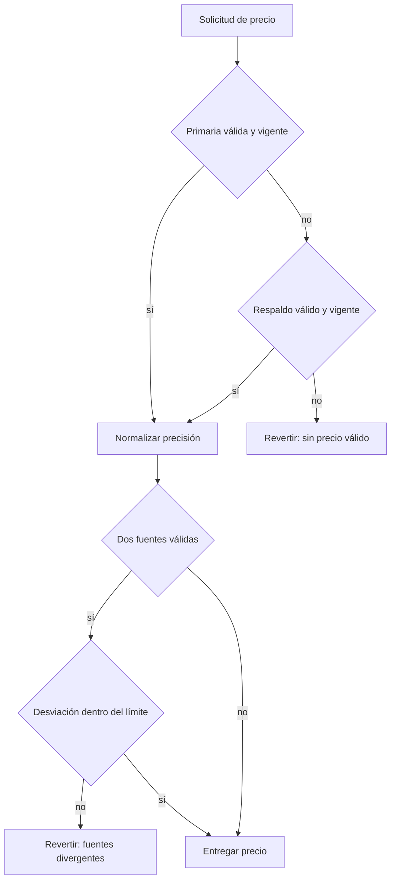
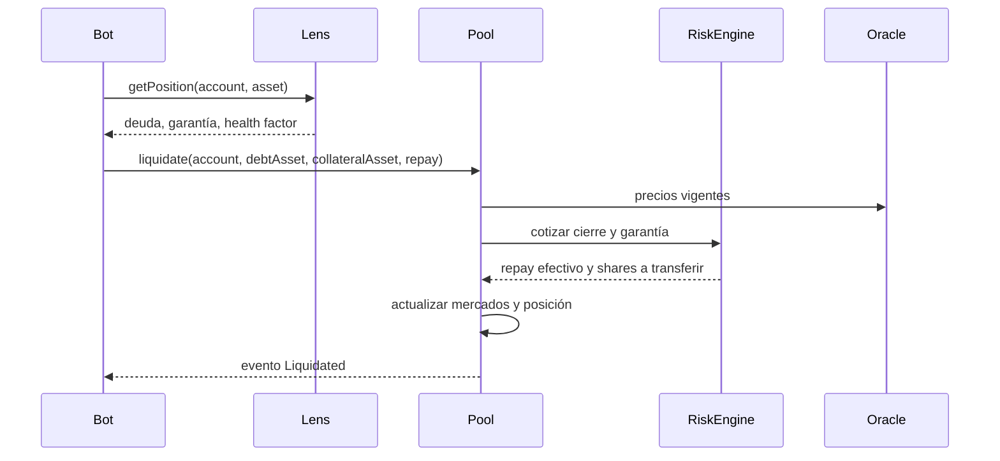

# Oráculos y liquidaciones

## Resolución de precios

`KairoOracleRouter` consulta una fuente primaria y, cuando está configurada, una fuente de respaldo. Cada lectura conserva valor, decimales y marca temporal.

Se rechazan valores nulos, marcas temporales futuras, observaciones vencidas y precisiones no admitidas. La normalización no convierte una fuente de baja calidad en una fuente fiable; solo alinea unidades.

## Parámetros por activo

- `priceFeed`: adaptador aprobado;
- `priceMaxAge`: antigüedad máxima;
- `assetDecimals`: precisión del activo de reserva;
- `loanToValueBps`: capacidad de nueva deuda;
- `liquidationThresholdBps`: frontera de liquidación;
- `liquidationBonusBps`: compensación del liquidador;
- `closeFactorBps`: fracción máxima de deuda por operación.

## Flujo de liquidación

El bot debe fijar límites propios, simular la llamada y contemplar cambios entre simulación e inclusión. No debe asumir que una cotización anterior seguirá disponible.

## Incorporación de una fuente

1. Verificar interfaz, decimales y semántica de la marca temporal.
2. Medir latencia y frecuencia en condiciones normales y de congestión.
3. Comparar contra una fuente independiente durante un periodo representativo.
4. Definir edad máxima y desviación acordes con la volatilidad del activo.
5. Probar valores nulos, futuros, vencidos, extremos y divergentes.
6. Documentar responsable de pausa, alternativa y criterio de reactivación.

## Incidentes

Ante una fuente degradada, la primera medida debe reducir exposición: deshabilitar nuevo préstamo o pausar el mercado según el alcance. Cambiar una fuente modifica una frontera de confianza y exige revisión de gobernanza; no es una operación rutinaria de disponibilidad.
